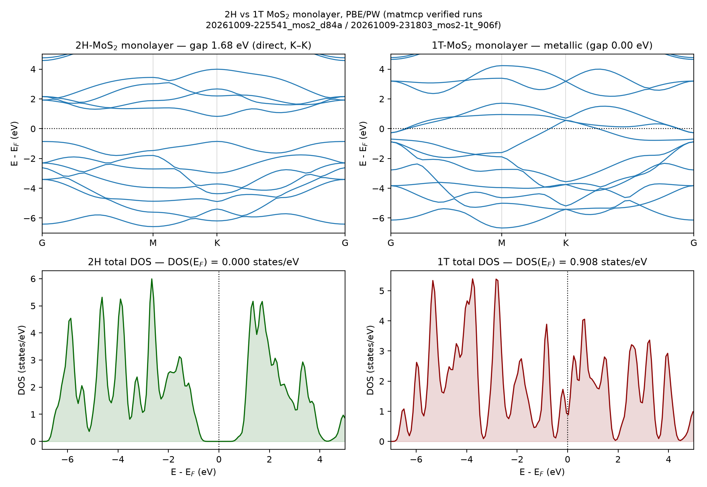
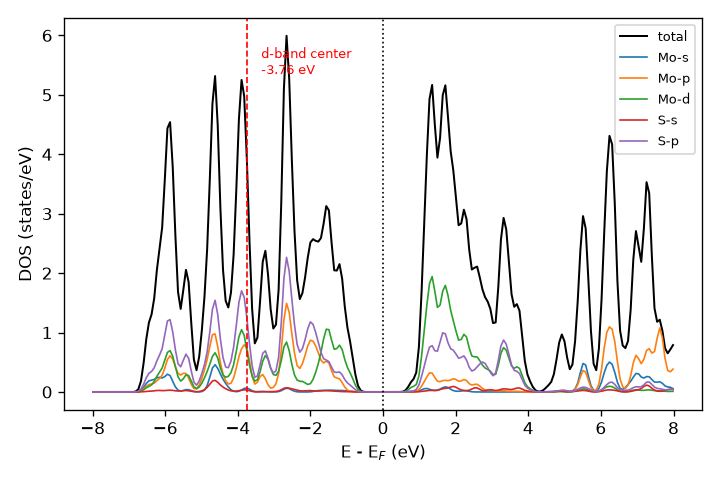

<div align="center">

# matmcp

**抗幻觉的材料计算 MCP 工具链**<br/>
AI 的每一句结论都必须有机器出处

[](LICENSE)
[](pyproject.toml)
[](https://gpaw.readthedocs.io/)
[](https://github.com/modelcontextprotocol)

自然语言 → 结构获取 → 结构弛豫 → 能带/态密度 → **机器验收**<br/>
零商业 license、零集群，一台笔记本端到端跑通可验证的 DFT 工作流

[事故与迭代记录](docs/experiments.md) · [运行物证](evidence/README.md) · English 见文末

</div>

---



> 上图由两次通过收敛门与物理校验的真实运行机器导出（[2H run 物证](evidence/20261009-225541_mos2_d84a/) · [1T run 物证](evidence/20261009-231803_mos2-1t_906f/)）：
> 2H-MoS2 单层带隙 **1.677 eV（K–K 直接）**，vs Materials Project 参考 1.66 eV；
> 1T-MoS2 判定**金属性**（费米能级处 DOS = 0.908 states/eV）——判定依据不是目测，
> 而是 k 点扫描证据链（gap 通道全程振荡不收、能量通道收敛），存于 run 的 `summary.json`。

## 为什么做这个

计算材料的工作流里，真正消耗人的不是"点鼠标"，而是写输入、盯收敛、处理报错、解读输出。
LLM agent 可以串起整条流程，但科学计算容不得幻觉——**数字算对了、物理解读编错了**是最常见的故障
（本项目开发期间就抓到实例：agent 看着能带图"目测"出错误的直接/间接带隙结论，
而正确答案就躺在它没读的输出文件里，见 [E1](docs/experiments.md)）。

matmcp 的对策：**验收器层（verifier）作为一等公民**。Agent 负责调度，确定性代码负责判断对错。

## 验收器是干什么的

- **收敛门是真的**：自动扫描截断能与 k 点网格。判据对准产品物理量——k 点轴双判据
  （ΔE<5 meV/atom 且 Δgap<0.02 eV），截断能轴主判据为带隙稳定度（Δgap<0.02 eV；
  绝对 PW 能量渐近收敛，跨截断能比较本无物理意义）。
  **未过门则不产出任何能带/DOS/带隙"最终结果"**（中间产物保留仅供取证）。
- **金属体系也管**：金属的"带隙"是 k 采样噪声而非物理量——smeared-metal 回退规则
  （gap 通道全程不收 + 最密网格 gap < 3×FD 展宽 + 能量通道已收敛，三者同时满足才放行并标记
  `metallic_detected`），经全部历史扫描回归零误伤，1T-MoS2 实证通过（[E13](docs/experiments.md)）。
- **物理校验**：带隙 vs Materials Project 参考值比对、弛豫收敛与残余力、结构漂移检查、
  直接/间接带隙由本征值数值导出（不许目测）。
- **有限自动重试**：参数类失败 → 自动调参重跑（≤2 次），仍败则带根因明确拒绝，
  绝不输出"看似正常"的垃圾。
- **完整证据链**：每次运行的参数、日志、图、验收结论全部落盘，静态记录页可回看。
- **边界自知**：带隙校验是"与 MP 的 PBE 级参考值的一致性检查"，不是对实验值的正确性认证
  （例：GaAs 算 0.205 eV 判 pass，实验值 1.52 eV——PBE 系统性低估不在此工具修复范围内）。
  验收器管的是"算得规不规范"，不管"泛函选得对不对"。

## 架构

```
agent 客户端 (Kimi Code / Claude Code / 任意 MCP client)
        │ stdio MCP
┌───────┴────────────────────────────────────────┐
│ matmcp server (FastMCP)                        │
│  fetch_structure ─ Materials Project / 内置构建 │
│  relax_structure ─ GPAW (PW, PBE，MPI 并行实证) │
│  calc_band_dos   ─ 能带 + DOS + VBM/CBM 导出    │
│  calc_pdos       ─ 轨道投影 DOS + d 带中心      │
│  check_convergence / verify_run ─ 验收器        │
│  run_verified_workflow ─ 一条命令的完整验证管线 │
└───────┬────────────────────────────────────────┘
        │ ASE 提供结构层复用；GPAW + QE 双引擎已实证（同一 MoS2 流程带隙差 0.016 eV），VASP+Slurm 二期
   runs/<run_id>/  全部产物：cif / gpw / txt 日志 / png / *.json 证据
   runs/index.html 运行记录页
```

## 实测示例

### MoS2 单层：2H vs 1T（2026-10-09，run_verified_workflow 全管线）

| 量 | 2H-MoS2 | 1T-MoS2 |
|---|---|---|
| verdict | **pass**（gap vs MP 偏差 0.017 eV） | **pass_with_warnings**（唯一 warn = MP 亚稳相标注，如实保留） |
| 带隙（机器导出） | 1.677 eV，direct @K–K | 0.000 eV，**metallic**（收敛门 smeared-metal 规则判定） |
| 费米能级处 DOS | 0.000 states/eV | 0.908 states/eV |

### 轨道投影 DOS 与 d 带中心



> `calc_pdos` 从已完成 run 的 `gs.gpw` 重启动后处理：元素 × s/p/d 通道投影，
> Mo d 带中心 **−3.757 eV**（占据态口径，∫E·ρ_d/∫ρ_d，E ≤ E_F）机器导出，标注线自动绘制。
> 价带 Mo-d/S-p 杂化、导带底 Mo-d 为主——与教科书图像一致。

### 五材料回归（2026-08-12，run_verified_workflow 全管线）

| 材料 | verdict | 带隙 (eV) | MP 参考 (eV) | 带隙类型（机器导出） |
|---|---|---|---|---|
| MoS2 单层 | **pass** | 1.675 | 1.66 | direct @K–K |
| Si (mp-149) | **pass** | 0.594 | 0.610 | indirect，VBM@Γ / CBM@[0.44,0,0.44] |
| GaAs (mp-2534) | **pass** | 0.205 | 0.184 | direct @Γ–Γ |
| 金红石 TiO2 (mp-2657) | **pass** | 1.875 | 1.772 | direct @Γ–Γ |
| LiCoO2 (mp-22526) | **fail（正确行为）** | 1.146 | 0.662 | PBE 对 Co 3d 强关联体系不可信，系统拒绝并给出根因 |

注：TiO2 触发了收敛判据设计修正——绝对 PW 能量渐近收敛（Ti PAW 600→800 eV 仍
67 meV/atom），但带隙在 600 eV 已稳定到 0.0003 eV。截断能轴判据现已对准带隙稳定度
（Δgap<0.02 eV），k 点轴维持双判据。完整事故/决策记录见 [docs/experiments.md](docs/experiments.md)。

<details>
<summary><b>坦白三条</b>（敌意审查后主动写明的边界）</summary>

1. 表中为各材料**最终一次**运行的 verdict；历史尝试（含未过收敛门的中间态
   pass_with_warnings）全部留在 `runs/index.html`，未删未藏。
2. MoS2 行的"MP 参考 1.66"是内置 builder 路径的硬编码常数（出处 mp-1023924），
   非实时查库；其余四个材料均为实时 MP API 查询。
3. 带隙校验证成的是"与 MP 的 PBE 级实现一致"，不是"与实验一致"——
   GaAs 判 pass 的 0.205 eV 对实验值 1.52 eV 偏差 87%，这是 PBE 泛函的系统性局限，
   不是本工具的判官范围。

</details>

回归还实锤了验收器的存在价值：开发中抓到 agent 看着能带图"目测"出错误的间接带隙结论
（正确答案 K–K 直接就写在它没读的输出文件里）——现在 VBM/CBM 全部机器数值导出，
agent 只许引用，不许目测。

## 快速开始

环境：WSL2 Ubuntu（GPAW 无 Windows 原生支持）。

```bash
# WSL 内
conda create -n matmcp -c conda-forge python=3.11 gpaw ase pymatgen matplotlib
conda activate matmcp
pip install mp-api fastmcp
pip install -e .
echo 'MP_API_KEY=你的key' > ~/.config/matmcp/env && chmod 600 ~/.config/matmcp/env
```

MCP 客户端配置（Kimi Code 示例，`.kimi-code/mcp.json` 已随仓库提供）：
通过 `wsl -d Ubuntu -- bash -lc "... conda activate matmcp && python -m matmcp.server"` 启动。

然后对 agent 说一句：**"算一下 MoS2 单层的能带和态密度"**。

## 工具列表

| 工具 | 作用 |
|---|---|
| `fetch_structure` | MP 按化学式/mp-id 拉结构，或内置构建器（2H/1T-MoS2）；返回 run_id + MP 参考带隙 |
| `relax_structure` | GPAW 结构弛豫，返回能量/残余力/收敛性 |
| `calc_band_dos` | 能带+DOS，机器导出带隙/VBM/CBM/直接间接属性/费米处 DOS |
| `calc_pdos` | 轨道投影 DOS（元素×s/p/d），机器导出 d 带中心（仅 GPAW 腿，需 gs.gpw） |
| `check_convergence` | 截断能/k 点自动收敛测试，给出推荐参数；smeared-metal 金属体系回退 |
| `verify_run` | 物理校验：弛豫、漂移、带隙 vs MP，pass/warn/fail + 修复建议 |
| `run_verified_workflow` | **默认入口**：全流程 + 收敛门 + 自动重试 + 验收 |
| `get_run_artifacts` | 列出某次运行的全部产物 |

## 路线图

- [x] GPAW 引擎 + 验收器 + 运行记录页
- [x] QE 引擎适配（双引擎 MoS2 对比：1.6772 vs 1.6935 eV，同为直接带隙，Δ=0.016 eV）
- [x] 金属体系支持（smeared-metal 收敛门回退，1T-MoS2 实证，[E13](docs/experiments.md)）
- [x] `calc_pdos`：轨道投影 DOS + d 带中心导出
- [x] GPAW MPI 并行弛豫（47 原子超胞实证；坑见 [E14](docs/experiments.md)）
- [ ] VASP 适配层 + Slurm 提交/轮询/报错恢复（接真实毕设课题）
- [ ] 吸附能工作流（表面 slab + 吸附质 + 专属验收判据）
- [ ] 多材料高通量回归

## 参考

- [VASPilot (arXiv 2508.07035)](https://arxiv.org/abs/2508.07035) — MCP+多智能体的 VASP 自动化（需集群与 VASP license）
- [mcp-atomictoolkit](https://github.com/XirtamEsrevni/mcp-atomictoolkit) — ASE/pymatgen 的 MCP 封装（file-first 设计来源）

---

<details>
<summary><b>English version</b></summary>

**matmcp** is an MCP toolchain that lets an LLM agent run verified DFT workflows end-to-end
on a laptop — no commercial license, no cluster required. The agent orchestrates;
deterministic code decides what's true.

Core idea: **a verifier layer as a first-class citizen**. Automated convergence gates
(cutoff / k-grid sweeps; k-axis: ΔE<5 meV/atom AND Δgap<0.02 eV, cutoff axis gated on
gap stability; smeared-metal fallback for metallic systems), physics checks (band gap vs
Materials Project reference — a consistency check against PBE-level values, not experimental
accuracy —, relaxation and drift checks, machine-derived direct/indirect gap character:
agents quote numbers, never eyeball plots), bounded auto-retry with root-cause refusal
(an unopened gate means NO final results, forensics only), and a full on-disk evidence
chain per run rendered into a static run-record page.

Demo results (2H vs 1T MoS2 monolayers, figure above): 2H gap **1.677 eV, direct at K**
(MP ref 1.66 eV); 1T correctly detected **metallic** via the convergence gate's
smeared-metal rule (gap channel never stabilizes across the k sweep while the energy
channel converges — evidence chain stored in the run's summary.json). Orbital-projected
DOS with machine-derived d-band center (−3.757 eV, occupied-states window) via `calc_pdos`.

Stack: FastMCP + ASE + GPAW/QE (both plane-wave PBE) + pymatgen/mp-api, runs inside
WSL2 on Windows. Dual-engine parity is tested, not claimed: the same MoS2 workflow
gives 1.6772 eV (GPAW) vs 1.6935 eV (QE), both direct at K (Δ=0.016 eV).

</details>
